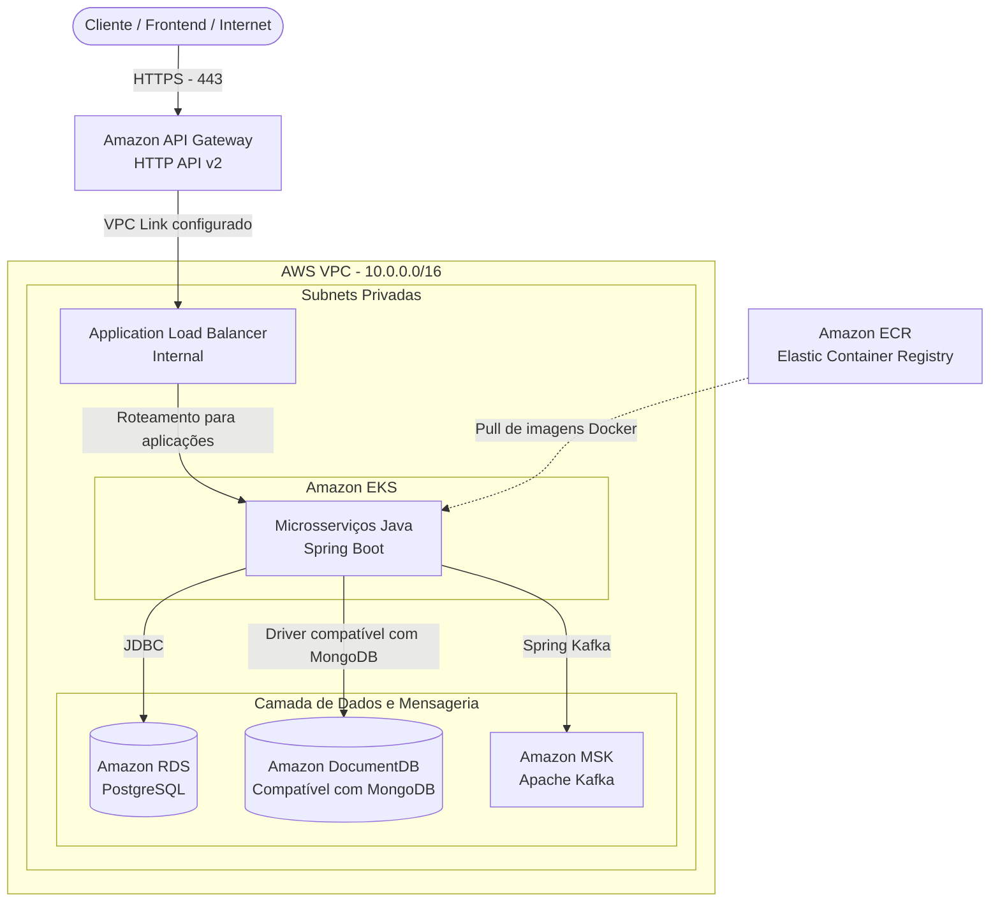
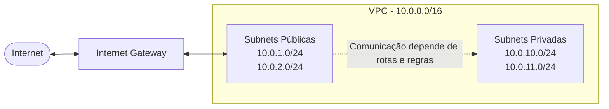
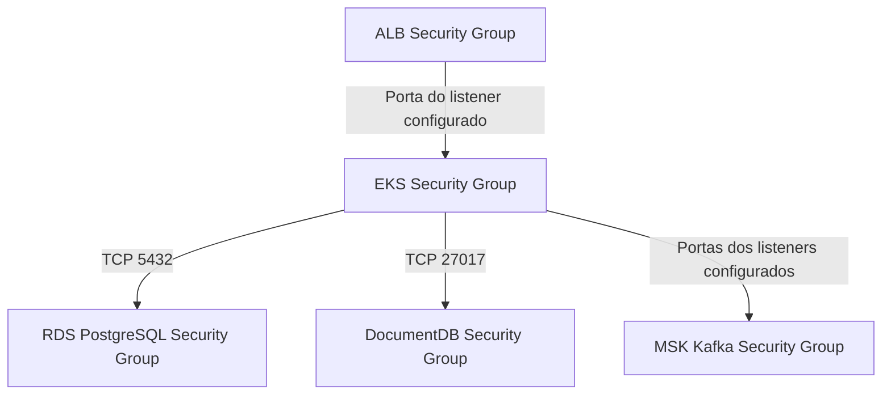
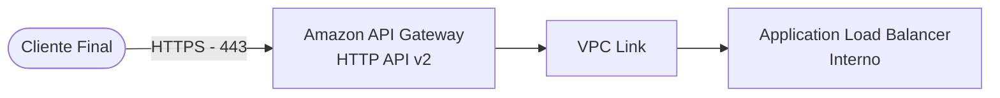
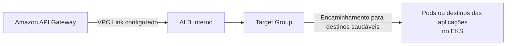
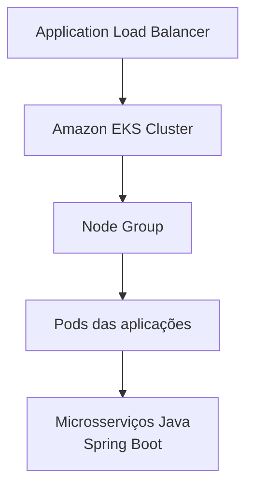
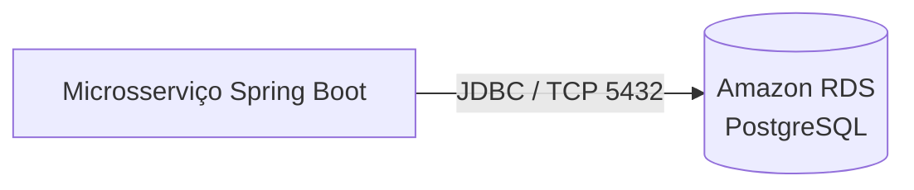
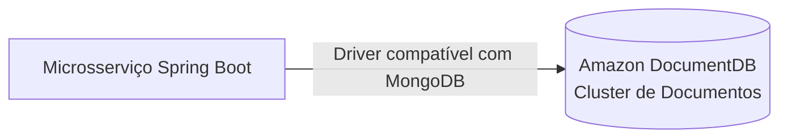
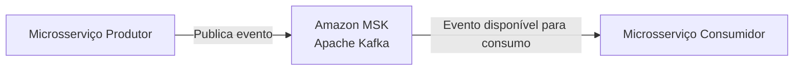

# 🚀 Enterprise Inventory Control Infrastructure (AWS + Terraform)

[](https://www.terraform.io/)
[](https://aws.amazon.com/)
[](https://microservices.io/)

Infraestrutura de microsserviços escalável, segura e orientada a eventos, provisionada na **AWS utilizando Terraform modularizado**.

O projeto fornece a infraestrutura para um ecossistema backend desenvolvido em **Java com Spring Boot**, aplicando boas práticas de segurança de rede, alta disponibilidade, isolamento de recursos e infraestrutura como código (*Infrastructure as Code — IaC*).

---

## 🏗️ 1. Visão Geral da Arquitetura (Fluxo Geral)

O diagrama abaixo apresenta a arquitetura geral da infraestrutura, desde a entrada das requisições dos clientes até a comunicação entre as aplicações, os bancos de dados e o serviço de mensageria.



### Resumo do fluxo

1. Requisição Externa: O cliente envia uma requisição HTTPS (- 443) para o Amazon API Gateway (HTTP API v2).
2. Encaminhamento via VPC Link: O API Gateway encaminha o tráfego de forma segura para o Application Load Balancer (ALB) Interno localizado na VPC através de um VPC Link configurado.
3. Roteamento Interno: O ALB recebe e distribui as requisições HTTP para os microsserviços Java com Spring Boot executados no Amazon EKS.
4. Provisionamento de Imagens: Os microsserviços no EKS realizam o pull de suas imagens de container diretamente do Amazon ECR.
5. Persistência de Dados: Os microsserviços persistem e consultam dados relacionais no Amazon RDS (PostgreSQL) via JDBC e dados semiestruturados no Amazon DocumentDB.
6. Mensageria Assíncrona: A troca de mensagens e eventos entre os microsserviços ocorre de forma assíncrona utilizando o Amazon MSK (Apache Kafka) com o Spring Kafka.   

> **Nota técnica:** o diagrama representa a arquitetura pretendida. A conectividade entre o API Gateway e o ALB privado depende de um VPC Link e de uma integração compatível devidamente configurados. O encaminhamento do ALB para as aplicações no EKS também depende dos listeners, target groups e do mecanismo de integração escolhido.

---

## 🔍 2. Detalhes, Motivação e Fluxo Específico de Cada Recurso

Esta seção detalha os oito principais recursos da infraestrutura, explicando por que cada um existe na arquitetura e como participa do fluxo de comunicação.

---

### 🌐 2.1. VPC (Virtual Private Cloud) — O Prédio da Empresa

**Por que existe na arquitetura?**

A VPC é a base da infraestrutura de rede na AWS. Ela permite isolar logicamente os recursos do projeto em uma rede virtual controlada, com endereçamento IP, tabelas de rotas e controles de tráfego definidos conforme as necessidades da aplicação.

**Como está estruturada**

A rede utiliza a faixa `10.0.0.0/16` e é planejada com subnets públicas e privadas:

- **Subnets públicas:** destinadas a recursos que precisam de conectividade com a Internet, conforme suas rotas e configurações.
- **Subnets privadas:** destinadas a aplicações e bancos de dados que não precisam de exposição direta à Internet.

**Fluxo específico**



**Benefícios**

- Isolamento lógico dos recursos.
- Controle de tráfego por meio de rotas e regras de segurança.
- Separação entre recursos públicos e privados.
- Base para implementar uma arquitetura com defesa em profundidade.

> **Nota:** uma subnet ser pública ou privada depende principalmente de sua tabela de rotas. A comunicação entre subnets também depende das rotas e dos controles de rede configurados.

---

### 🛡️ 2.2. Security Groups — O Sistema de Crachás (Zero Trust)

**Por que existem na arquitetura?**

Security Groups são firewalls virtuais stateful que controlam o tráfego de entrada e saída dos recursos associados. O projeto busca aplicar o princípio do menor privilégio, permitindo apenas as comunicações necessárias entre os componentes.

**Regras de comunicação previstas**



**Política de segurança**

- O ALB aceita somente o tráfego permitido por suas regras de entrada.
- As aplicações do EKS acessam os bancos de dados pelas portas autorizadas.
- O acesso ao DocumentDB é controlado pelas regras específicas do serviço.
- O acesso ao MSK depende das portas dos listeners e do protocolo de autenticação configurado.
- Sempre que aplicável, as regras devem referenciar Security Groups em vez de liberar faixas de IP amplas sem necessidade.

**O diferencial da abordagem**

A intenção é que os bancos de dados e o Kafka aceitem conexões somente das origens autorizadas, incluindo o Security Group associado às aplicações, quando essa associação for compatível com a configuração do serviço.

> **Nota:** o princípio Zero Trust é uma abordagem de segurança mais ampla e não é implementado exclusivamente por Security Groups. As portas efetivas precisam corresponder à configuração real dos listeners e dos serviços.

---

### 🚪 2.3. API Gateway (HTTP API v2) — A Recepção Principal

**Por que existe na arquitetura?**

O Amazon API Gateway funciona como ponto de entrada das requisições externas para as APIs da aplicação. Ele permite centralizar o gerenciamento de rotas e integrar recursos como CORS, throttling e mecanismos de autenticação e autorização.

**Fluxo específico**



**Responsabilidades**

- Receber requisições por HTTPS.
- Encaminhar requisições para uma integração backend configurada.
- Gerenciar rotas e configurações de CORS.
- Aplicar throttling conforme as configurações definidas.
- Integrar mecanismos de autenticação e autorização.

> **Nota:** o VPC Link precisa estar configurado e associado a uma integração compatível com o ALB. A existência do API Gateway, isoladamente, não estabelece conectividade com a rede privada.

---

### ⚖️ 2.4. Application Load Balancer (ALB) — O Gerente de Tráfego Interno

**Por que existe na arquitetura?**

O Application Load Balancer distribui as requisições entre os destinos configurados para as aplicações. Nesta arquitetura, ele é planejado para operar internamente (`internal = true`), sem exposição direta à Internet.

**Configurações previstas**

- Implantação em subnets privadas.
- Listeners configurados para os protocolos necessários.
- Target groups associados às aplicações.
- Regras de roteamento para os serviços backend.
- Verificações de integridade dos destinos.

**Fluxo específico**



**Benefícios**

- Distribuição de tráfego.
- Verificações de integridade dos destinos.
- Roteamento baseado nas regras configuradas.
- Separação entre a entrada da API e o processamento das aplicações.

> **Nota:** o encaminhamento para pods depende da integração entre o ALB e o EKS, incluindo o controlador ou mecanismo de integração escolhido e a configuração dos target groups.

---

### ☸️ 2.5. EKS (Elastic Kubernetes Service) — Os Escritórios de Processamento

**Por que existe na arquitetura?**

O Amazon EKS fornece o ambiente Kubernetes gerenciado responsável pela execução e pelo gerenciamento dos microsserviços Java com Spring Boot.

**Recursos e funcionalidades**

- Gerenciamento do ciclo de vida dos containers.
- Recuperação de workloads conforme as políticas definidas.
- Escalabilidade horizontal das aplicações, quando configurada.
- Distribuição das aplicações entre os nós disponíveis.
- Gerenciamento de Deployments, Services e Pods.
- Integração com mecanismos de observabilidade e segurança.

**Fluxo específico**



**Configuração prevista**

O projeto considera um node group com instâncias `t3.medium`. O tipo de instância, a quantidade de nós e a estratégia de escalabilidade devem ser definidos conforme a carga esperada e os requisitos operacionais.

**Benefícios**

- Orquestração de containers.
- Recuperação de aplicações conforme os recursos declarativos do Kubernetes.
- Possibilidade de escalar aplicações e capacidade computacional.
- Organização dos microsserviços em um ambiente gerenciado.

> **Nota:** o tipo de instância e o tamanho do node group não garantem, por si só, alta disponibilidade. Ela depende também da distribuição dos recursos entre zonas de disponibilidade, da capacidade disponível e das configurações de escalabilidade e recuperação.

---

### 🗄️ 2.6. RDS PostgreSQL — O Cofre Relacional

**Por que existe na arquitetura?**

O Amazon RDS for PostgreSQL armazena dados relacionais e transacionais utilizados pelas aplicações. É adequado para dados que exigem relacionamentos, restrições de integridade e operações transacionais.

**Exemplos de utilização**

- Cadastro de produtos.
- Pedidos e movimentações de estoque.
- Dados estruturados da aplicação.
- Informações que exigem consistência transacional.

**Configurações de segurança previstas**

- Banco de dados sem exposição pública (`publicly_accessible = false`).
- Regras de acesso restritas às origens autorizadas.
- Conexões PostgreSQL pela porta TCP 5432.
- Gerenciamento seguro de credenciais.
- Criptografia e backups conforme os requisitos e a configuração do recurso.

**Fluxo específico**



**Benefícios**

- Persistência de dados relacionais.
- Suporte a transações ACID.
- Recursos de backup e recuperação conforme a configuração.
- Integração com aplicações Java por meio de drivers JDBC.

> **Nota:** a versão do PostgreSQL, a estratégia de backup, a retenção, a criptografia e a configuração de alta disponibilidade devem ser verificadas nos arquivos Terraform.

---

### 🍃 2.7. DocumentDB (MongoDB Compatible) — O Repositório de Documentos NoSQL

**Por que existe na arquitetura?**

O Amazon DocumentDB é um serviço de banco de dados de documentos com compatibilidade com determinadas APIs e funcionalidades do MongoDB. Pode ser utilizado para armazenar documentos semiestruturados quando esse modelo atende às necessidades da aplicação.

**Exemplos de utilização**

- Documentos JSON.
- Dados com estruturas flexíveis.
- Informações semiestruturadas.
- Dados que se beneficiam de um modelo orientado a documentos.

**Configurações de segurança previstas**

- Implantação na rede privada.
- Controle de acesso por Security Groups.
- Comunicação pela porta TCP 27017, quando configurada para o endpoint utilizado.
- Uso de credenciais e conexões seguras.

**Fluxo específico**



**Benefícios**

- Modelo de dados orientado a documentos.
- Flexibilidade para determinados tipos de estruturas JSON.
- Integração com aplicações que utilizam drivers compatíveis.

> **Nota:** o DocumentDB não é uma implementação idêntica ao MongoDB. A compatibilidade depende das APIs e funcionalidades suportadas pelo serviço e pela versão utilizada.

---

### 📨 2.8. Amazon MSK (Apache Kafka) — O Sistema de Correio Assíncrono

**Por que existe na arquitetura?**

O Amazon Managed Streaming for Apache Kafka (Amazon MSK) fornece uma plataforma gerenciada para comunicação assíncrona orientada a eventos. Ele permite que os microsserviços publiquem e consumam eventos sem exigir que todo o processamento aconteça durante a requisição original.

**Exemplo de utilização**

Quando um produto é cadastrado, um microsserviço pode publicar um evento no Kafka. Outros microsserviços podem consumir esse evento e executar operações relacionadas, como atualizar projeções ou iniciar outros processos.

**Fluxo específico**



**Benefícios**

- Comunicação assíncrona entre microsserviços.
- Desacoplamento entre produtores e consumidores.
- Processamento orientado a eventos.
- Possibilidade de reprocessamento conforme a configuração.
- Suporte a múltiplos consumidores independentes.

**Configurações de segurança previstas**

- Acesso de rede controlado pelos Security Groups.
- Comunicação por listeners Kafka configurados.
- Autenticação e criptografia conforme os mecanismos habilitados no MSK.
- Controle de permissões de acesso aos tópicos.

> **Nota:** as portas utilizadas dependem do protocolo e do mecanismo de autenticação habilitado. As regras de rede devem corresponder à configuração real dos listeners do cluster.

---

## 📂 3. Estrutura de Pastas do Projeto

O projeto utiliza uma organização modular do Terraform para separar os componentes da infraestrutura e facilitar sua manutenção.

```text
.
├── main.tf                 # Orquestração dos módulos
├── variables.tf            # Variáveis globais do projeto
├── outputs.tf              # Saídas e endpoints da infraestrutura
├── providers.tf            # Configuração dos providers
└── modules/
    ├── vpc/                # VPC, subnets, rotas e Internet Gateway
    ├── security/           # Security Groups e regras de segurança
    ├── api_gateway/        # API Gateway HTTP API v2
    ├── loadbalancer/       # Application Load Balancer interno
    ├── eks/                # Cluster EKS e Node Groups
    ├── rds/                # Banco de dados PostgreSQL
    ├── documentdb/         # Banco de dados de documentos
    └── msk/                # Amazon MSK e Apache Kafka
```

> A estrutura apresentada é ilustrativa e deve ser ajustada para corresponder aos arquivos e diretórios existentes no repositório.

---

## ⚙️ 4. Como Provisionar a Infraestrutura

### 4.1. Pré-requisitos

Antes de iniciar, verifique se os seguintes componentes estão disponíveis:

- Terraform na versão 1.5.0 ou superior.
- AWS CLI instalado.
- Credenciais AWS configuradas.
- Permissões IAM adequadas para criar e gerenciar os recursos necessários.
- Acesso ao repositório do projeto.

Documentação oficial:

- [Instalação do Terraform](https://developer.hashicorp.com/terraform/install)
- [Instalação da AWS CLI](https://docs.aws.amazon.com/cli/latest/userguide/getting-started-install.html)
- [Configuração de credenciais AWS](https://docs.aws.amazon.com/cli/latest/userguide/cli-configure-files.html)

### 4.2. Configurar as credenciais AWS

Configure as credenciais usando a AWS CLI:

```bash
aws configure
```

Para verificar a identidade autenticada:

```bash
aws sts get-caller-identity
```

**Segurança:** nunca versione chaves de acesso, senhas ou outros segredos no repositório.

### 4.3. Inicializar o Terraform

Na raiz do projeto, execute:

```bash
terraform init
```

Esse comando inicializa o diretório de trabalho e prepara os providers e módulos necessários.

### 4.4. Formatar e validar a configuração

Execute:

```bash
terraform fmt -recursive
terraform validate
```

O primeiro comando aplica a formatação padrão aos arquivos Terraform. O segundo verifica a consistência sintática e estrutural da configuração.

### 4.5. Revisar o plano de execução

Execute:

```bash
terraform plan
```

Analise os recursos que serão criados, alterados ou destruídos antes de prosseguir.

### 4.6. Provisionar a infraestrutura

Se o plano estiver correto e você tiver autorização para prosseguir, execute:

```bash
terraform apply
```

Revise o plano apresentado e confirme a operação quando solicitado.

> **Atenção:** os recursos AWS podem gerar custos. Verifique os preços dos serviços, as configurações de alta disponibilidade e os recursos que serão criados antes de confirmar o provisionamento.

---

## 🔒 5. Boas Práticas de Segurança

O projeto busca seguir boas práticas de segurança para infraestrutura em nuvem:

- **Princípio do menor privilégio:** conceder somente as permissões necessárias.
- **Isolamento de rede:** manter os bancos de dados em subnets privadas.
- **Controle de tráfego:** restringir o acesso por meio de Security Groups.
- **Proteção de credenciais:** evitar armazenar segredos diretamente no código.
- **Criptografia:** habilitar criptografia em trânsito e em repouso conforme os recursos e requisitos aplicáveis.
- **Auditoria:** avaliar o uso de logs e serviços de monitoramento da AWS.
- **Alta disponibilidade:** distribuir recursos críticos entre zonas de disponibilidade quando necessário.
- **Gestão de estado:** proteger o arquivo de estado do Terraform, especialmente quando armazenado remotamente.

Essas práticas dependem da implementação efetiva dos recursos e de suas respectivas configurações.

---

## 👨‍💻 6. Autor

Desenvolvido por **Ewerton Soares da Silva** como parte do aprofundamento prático em arquitetura Cloud AWS, infraestrutura como código (Terraform) e microsserviços desenvolvidos com Java e Spring Boot.
